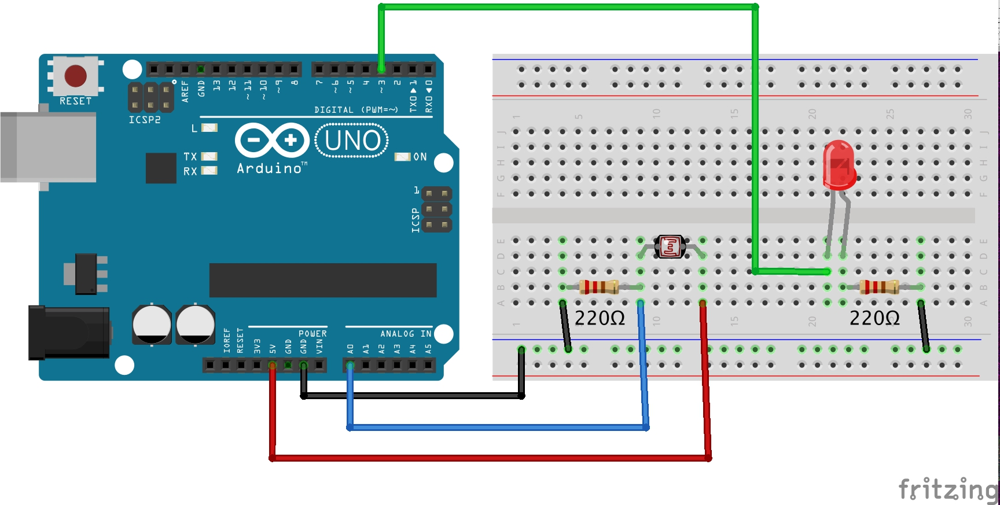

# Photo-Resistor (LDR) 

A photoResistor –also called a Light Dependant Resistor (LDR)– it’s a variable resistor whose resistance changes based on the amount of light hitting it.

WARNING!
An LDR does not measure lux (precise light intensity). It only gives a relative light level. To measure lumens, [see this tutorial instead](https://github.com/kingston-hackSpace/Light_sensor_BH1750)

### HOW IT WORKS

Light intensity produces changes in the LDR resistance capacity.
- Bright light = low resistance
- Dim light = high resistance

### WHEN TO USE AN LDR?

LDRs are great for:
- Relative brightness detection (e.g., is it bright or dark?)
- Creative triggers (e.g., interactive installations reacting to light or shadow)

# TUTORIAL
Turn an LED on/off based on environmental brightness using an LDR.

----
### HARDWARE
- ARDUINO UNO
- LDR
- LED
- Resistor 220 ohms (x2)

----
### WIRING



Click on image to expand

----
### CODE

- Upload the following code to your Arduino Uno board

```
#define LDR A0 
#define LED 3 
#define Threshold 50 

void setup() {
  Serial.begin(9600);
  pinMode(LED, OUTPUT);
}

void loop() {
  int LDR_Values = analogRead(LDR);
  Serial.println(LDR_Values); //monitor readings 0-1023

  if (LDR_Values < Threshold){
    digitalWrite(LED, HIGH);
  } else {
    digitalWrite(LED, LOW);
  }
}
```

- Open the Serial Monitor to visualize the upcoming numbers, this will help you identify if you need to change your Threshold. 


----
### MORE INFO
https://arduinoyard.com/ldr-with-arduino/

https://www.circuitbasics.com/pairing-a-light-dependent-resistor-ldr-with-an-arduino-uno/ 

